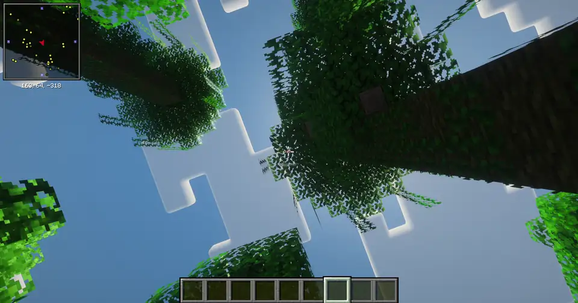

# Poking at a Seamless KM Switch: What the UNNLINK 2234 Actually Sends

I have a Windows desktop and a Mac on the same desk, and one keyboard and one
mouse between them. The glue is an UNNLINK 2234, a small "seamless" KM switch:
push the mouse past the edge of one screen and it shows up on the other
computer, with the keyboard following along. No software, no network, just two
USB cables.

It mostly works. But two things I use every day broke as soon as I started
using it: my CapsLock setup on Windows, and Minecraft. So I spent an evening
with Codex logging raw input on both machines and running small controlled
experiments to figure out what the box is actually doing.

---

## Background

### Keyboard: a CapsLock script that stopped working

I love one small macOS design decision: a short press of CapsLock switches
between the Chinese and English input methods, while a long press of CapsLock
(or Ctrl+CapsLock) still does its original job and toggles case. One key, two
jobs, and they never get in each other's way.

Windows has nothing like it, so I wrote an AutoHotkey script to replicate it:
a short tap switches the input method, a long press or Ctrl+CapsLock toggles
case. It worked well for a long time.

Then I started using the KM switch, and the script broke. Long presses and
Ctrl+CapsLock no longer behaved like long presses and Ctrl+CapsLock.

My first suspect was Logitech. My keyboard is an MX Keys on its own wireless
receiver, and I assumed the keyboard or the receiver had some special
CapsLock behavior of its own. Only after a proper side-by-side comparison
(described below) did the blame land on the KM switch.

### Mouse: Minecraft became unplayable

The mouse story is simpler. With the mouse going through the KM, Minecraft
became unplayable. This is what it looks like:



*Minecraft with the mouse going through the UNNLINK 2234 KM switch: the camera
movement it produces when I look around.*

---

## The Setup

- **Hosts:** a Windows machine with a 4K primary display, and an Apple M4 Mac.
- **Devices:** a Logitech MX Keys and a wireless mouse, both plugged into the
  KM. A spare mouse plugged directly into Windows served as a control
  (and as an escape hatch).
- **How we worked:** I ran the experiments together with Codex. Codex ran on
  my Windows PC and could SSH over the LAN into the Mac, so it started the
  logging scripts on both machines and collected the logs. For each round,
  Codex told me exactly which physical actions to perform -- release
  everything, press this, hold that, cross to the other screen, wait a few
  seconds -- and I did them with the real keyboard and mouse. Codex then read
  both logs and we compared them with what I saw on screen.
- **Loggers:**
  - On Windows, a small C# tool listening to Raw Input and a low-level keyboard
    hook. Raw Input reports which physical device each event came from, so we
    could tell the KM apart from the directly connected receiver or the spare
    mouse.
  - On the Mac, a C program using IOHID (raw HID values) and a Core Graphics
    event tap (what the window system sees).

One small detail about the hardware: the product listing says the switch uses
an ASIX AX68002, while on the Mac it enumerates as "ASIX Electronics" with the
product string `AX68004`.

---

## Part 1: The Mouse

### Hypothesis: it just forwards the mouse

My first assumption was that the KM forwards the mouse's relative motion to
whichever computer is active, and simply decides when to switch.

The first control killed that idea. With the mouse plugged directly into
Windows, Raw Input reports ordinary relative motion: `flags=0`, small signed
deltas such as `x=-1, y=1`. Through the KM, the same mouse shows up as
`flags=1` -- `MOUSE_MOVE_ABSOLUTE` -- with large coordinate values.

**The KM converts relative mouse motion into absolute coordinates.** Anything
that wants raw relative deltas, such as mouse-look in a game, is now being fed
positions on a fixed grid instead.

### What coordinate space?

The HID report descriptor answers this directly. On both machines, the KM's
absolute pointer interface declares the same thing:

| Field | Value |
|---|---|
| Report ID | 4 |
| X | 16-bit, logical range **0..3840** |
| Y | 16-bit, logical range **0..2140** |
| Wheel | 8-bit relative, -127..127 |

Note the Y range: **2140, not 2160**. These numbers are the range the device
declares, not the resolution of any screen. They stay the same whether the
target is a 4K Windows display or a much smaller Mac desktop.

### Layer 2 on Windows: normalize to 0..65535

Windows does not hand an absolute HID value to applications as-is. Raw Input
normalizes absolute coordinates to 0..65535. Codex went through every
distinct value in the logs -- 1283 distinct X values and 1428 distinct Y
values -- and all of them are reproduced exactly by:

```text
rawX = floor(hX * 65535 / 3840)
rawY = floor(hY * 65535 / 2140)
```

Going one step further to screen pixels on the 3840x2160 primary display, a
static sample (raw `(18073, 38310)` landing at cursor `(1058, 1262)` in a
DPI-aware process) matches:

```text
pixelX = floor(rawX * 3840 / 65536)
pixelY = floor(rawY * 2160 / 65536)
```

### Layer 2 on the Mac: logical points

On the Mac, the interesting space is Core Graphics' logical points. The
built-in display currently reports bounds of 1470x956 points (rendered at
2940x1912 pixels; the panel itself is 2560x1664 -- three different scales,
none of which is the KM's). Codex paired HID values with nearby CG events,
and they fit:

```text
pointX ≈ hX * 1470 / 3840
pointY ≈ hY * 956  / 2140
```

For example, HID `(1920, 801)` lands at CG `(735.00, 357.83)`. Of about 58,600
time-adjacent candidate pairs Codex extracted, about 45,700 fit within 0.03
points combined error. The rest are most likely mismatched pairs from two asynchronous event
queues rather than a different mapping.

Most consecutive HID steps are multiples of 3, but the greatest common divisor
of all steps is 1, so it is not simply a fixed 3-unit grid.

### The multi-monitor surprise

Here is where the absolute mapping becomes visible to a normal user.

The KM's events carry the absolute flag but **not**
`MOUSE_VIRTUAL_DESKTOP`. On Windows that means the coordinates map onto the
*primary display*, not the whole virtual desktop. That predicts a strange
behavior, and the predicted behavior is exactly what happened:

1. With the spare (direct) mouse, I moved the cursor onto a secondary display
   to the right of the 4K primary. A tiny nudge of the KM mouse made the cursor
   jump back onto the primary display.
2. Pushing the KM mouse past the primary display's **right** edge went
   straight to the Mac, skipping the secondary display that sits there.
3. Pushing past the primary display's **left** edge *also* went to the Mac.
   Keep going in the same direction and you cycle Windows -> Mac -> Windows
   forever -- an infinite horizontal scroll across two machines.
4. **Top and bottom** edges simply clamp, on both machines.
5. Rearranging the Windows displays vertically did not help; the KM cursor
   still never entered the secondary display.
6. While the KM was on the Mac, the direct mouse could operate Windows freely,
   and moving the KM mouse did not yank control back. The KM keeps its own idea
   of which host is active; input from other devices does not change it.

So the working model is: the KM owns one absolute pointer space per host, sized
to that host's primary display, and both horizontal edges lead to "the other
host." The Windows monitor layout is irrelevant to it.

At one point the cursor seemed to drift vertically after repeated wraps (down
when going right, up when going left). The logs tell a different story:
near-instant wraps keep Y *exactly* unchanged, e.g. `x=102` to `x=65535` with
`y=41464` on both sides. The larger differences in round trips came from real
hand movement while the cursor was on the Mac.

---

## Part 2: The Keyboard

### The CapsLock mystery

Back to where this started. With the AutoHotkey script switched off, the raw
CapsLock events through the KM looked odd: every CapsLock "press" arrived as a
down/up pair within about a millisecond, regardless of how long I actually
held the key.

A sequence with markers made it clearer: press F8, hold CapsLock, tap F9 in
the middle, release CapsLock, press F10. Both machines saw F8, a CapsLock pulse,
and F10. **F9 never arrived** -- not in Raw Input, not in the keyboard hook,
not in the Mac's IOHID stream.

A cleaner version in Notepad: press `a`, hold CapsLock while tapping `a`
twice, release CapsLock, press `b`. The result through the KM was:

```text
aB
```

The two taps during the hold were simply gone, and the CapsLock toggle took
effect at release time.

### The control: Logitech or the KM?

This is where my Logitech theory got its fair test. If the MX Keys or its
receiver were doing something special with CapsLock, the behavior should
survive without the KM. So I plugged the receiver directly into Windows and
repeated the exact same sequence:

```text
aAAB
```

Both taps arrive, uppercase, while CapsLock is held, and CapsLock's down and up
events are separated by the real hold duration. Same keyboard, same receiver,
same keystrokes: `aB` through the KM, `aAAB` without it. The swallowing and the
release-time pulse come from the KM, and Logitech was off the hook.

It also explains exactly why my script broke. The script tells a short tap
from a long press by how long CapsLock stays down, and through the KM CapsLock
is *always* down for about a millisecond, so every press looks like a tap.

### What happens to keys you are already holding

Next question: what happens to *other* keys that are held when CapsLock goes
down?

- Holding Ctrl, then pressing CapsLock: Windows received a Ctrl **up** while I
  was still physically holding Ctrl, then the CapsLock pulse, then a Ctrl
  **down** again a few milliseconds later.
- Same with Shift: released, pulse, restored about 2.7 ms after the pulse.
- Same with an ordinary key: holding `a`, its autorepeat paused during the
  CapsLock hold and resumed after release.

Meanwhile, the mouse kept moving normally while CapsLock was held. This is not
a global pause of all forwarding.

The model that fits: **while CapsLock is held, the KM presents an empty
keyboard state to the host and swallows new taps. On release it sends an
instant CapsLock press/release to the currently active host, then restores
whatever keys are still physically held.**

That covers the other half of my broken script: by the time CapsLock arrives,
the KM has already released Ctrl, so Ctrl+CapsLock reaches Windows as a plain,
short CapsLock tap. My script interpreted it exactly that way and switched
the input method between Chinese and English instead of toggling case.

### Switching hosts does not release keys

The second set of experiments was about what happens to key state when the
mouse crosses to the other computer.

**Holding an ordinary key across the edge.** Hold `a` on Windows, cross to the
Mac, release `a` there, and come back with the mouse only. Windows kept
repeating `a` the whole time -- over 18 seconds and hundreds of repeated
key-downs in one run. The Mac saw nothing. Only pressing a key on Windows again
stopped it. The reverse direction showed the same thing in Mac form: the
accent picker stayed open because macOS still believed `a` was held.

**Holding a modifier.** Hold Shift on Windows, type `a`, cross to the Mac with
Shift still held, type `a`, release Shift, type `a`, return to Windows and type
`a`. Each machine printed `Aa`. On the Mac, the first `a` arrived together
with Left Shift in the same report. On Windows, Shift did not go up when I
left; it went up exactly when the next `a` arrived after returning.

So switching does not clear the source host, and it does not proactively
replay state to the destination. Something else is going on.

### The correction: the next report carries everything

My first reading of the "held `a`" experiment was that held ordinary keys do
not transfer to the destination at all. That turned out to be incomplete.

In a follow-up, I held `a` on Windows, crossed to the Mac, and then pressed
`b` *while still holding `a`*. The Mac printed `ab`: the `a` and the `b`
arrived with identical HID timestamps. And back on Windows, pressing `b` --
not `a` -- was enough to stop the stale `a` repeat.

That suggests a simpler working model for both directions:

> The KM keeps the real keyboard state. A keyboard report is sent only when
> something changes, and it goes to the currently active host. That report
> carries the *entire* current state. Hosts that are not active are left
> alone with whatever they last saw.

So the destination learns about held keys when the next keyboard change
happens, and the source gets corrected the next time any keyboard change is
sent to it.

The mouse buttons follow the same rule, but much more visibly, because mouse
movement generates reports constantly. Hold the left button on Windows and
cross to the Mac: the Mac immediately starts a selection, because the first
movement report on the Mac already says "left button down." Release the
button on the Mac, and Windows does not find out until the mouse comes back.
When I tried this while dragging a window, Windows received the button-up at
the far right edge on return, and the window snapped to the right side of the
screen. That is just Windows reacting to a release at the screen edge, not a
special KM feature.

### A weird one: `ababab`

This one was found by accident. Hold `a` on the Mac until the accent picker
appears, cross to Windows without releasing it, then also hold `b` on Windows.
Windows outputs:

```text
ababab...
```

Both keys repeat, alternating. In the logs, the first `a` and `b` downs share
the same receipt timestamp, the first repeat pair comes about 515 ms later,
then pairs arrive roughly every 31 to 33 ms. As a control, pressing and holding
`a` then `b` sequentially, directly on Windows, behaves normally: `a` stops
repeating as soon as `b` starts, and only `b` repeats.

The difference correlates with two keys showing up as newly pressed at the
same moment, which is exactly what the state-reconciliation model produces
on the destination.

### Does switching inject extra CapsLock presses?

Earlier, in some uncontrolled moments, I saw CapsLock pulses on Windows that I
could not account for. A plausible theory was that the KM resynchronizes
CapsLock state when switching hosts.

The test: a single intentional CapsLock tap on Windows, wait, cross to the
Mac, wait, type `a`, wait, return to Windows, wait, type `a`. No other
CapsLock presses, no fixing the case by hand.

Result: no extra CapsLock pulse anywhere. Not on switching, not on the first
keystroke after switching. Separately, holding CapsLock on one machine,
crossing, and releasing it on the other sends the pulse to whichever host is
active **at release time**, in both directions.

So under controlled conditions there is no automatic CapsLock replay.

---

## Summary of the Working Model

Putting everything together, this is the model that best fits what I
observed:

**Mouse**

- Relative motion from the mouse is converted into absolute coordinates:
  HID X 0..3840, Y 0..2140, Report ID 4.
- Windows normalizes those to 0..65535 using `floor(v * 65535 / max)`; the Mac
  maps them onto its logical desktop (1470x956 points here).
- Only the Windows primary display is reachable through the KM.
- Left and right edges cycle between the two hosts; top and bottom clamp.
- The KM tracks the active host itself; other input devices do not change it.

**Keyboard**

- Switching hosts neither releases keys on the source nor replays them on the
  destination.
- The next keyboard report reconciles the full key state on whichever host is
  active; inactive hosts keep stale state until they are active again and
  something changes.
- Mouse buttons work the same way, but the frequent movement reports make the
  transfer almost immediate.
- While CapsLock is held, held keys are released and new taps are swallowed;
  on release, an instant CapsLock pulse goes to the current host and still-held
  keys are restored.
- The direct-receiver baseline puts the CapsLock behavior on the KM, not the
  keyboard.
- Two keys arriving together on a newly active host can repeat in pairs
  (`ababab`).
- Plain switching does not produce extra CapsLock pulses.

---

## Open Questions

- **Mouse gain.** How do physical mouse counts become absolute steps? Is there
  gain, acceleration, clamping, or fractional accumulation inside the KM?
- **Resolution changes.** Does the HID range or the mapping change when a
  host's resolution or scaling changes?
- **What is on the wire.** What is the real report rate, and is the `ababab`
  repeat present in the USB reports themselves?
- **Firmware options.** The Mac also enumerates a relative mouse interface. Is
  there a relative or "gaming" mode that can be switched on?

The next tool is something that can send *exactly known* mouse reports into
the KM instead of my hand. A Raspberry Pi 4B can act as a USB HID gadget
through its USB-C port, which would let me send, say, `dx=1` every 20 ms for
100 reports and see precisely what comes out on each host. If that produces
anything interesting, it can be its own write-up.

---

## Takeaways

- A "seamless" KM switch is not a passthrough. This one rewrites mouse input
  into absolute positions and maintains its own model of keyboard state and
  host selection. Most of its quirks follow from those two decisions.
- Controls matter more than clever logging. The direct-receiver baseline and
  the direct-mouse comparison each settled an argument in one run.
- Suspect the newest thing in the chain. I spent a while blaming Logitech for
  a problem that appeared exactly when the KM switch did.
- Write down the hypothesis before you run the experiment. Two of my first
  conclusions here ("held keys do not transfer," "switching resyncs CapsLock")
  were wrong or incomplete, and only the next targeted experiment showed it.
